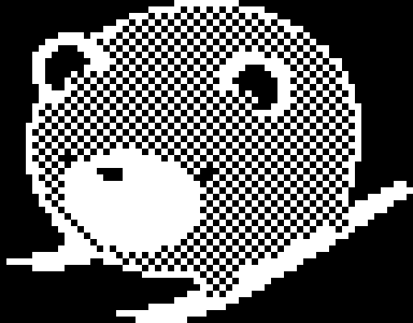

# Catchphrase 
---

## November 15, 2026 update:

The game is finally starting to progress; I've finally had time to sit down and learn how to use the Pico and the OLED screen I bought for it.

First up, I got the divider for the Pico and OLED printed from a friend at work so I can attach additional buttons and stuff to the board and keep the headers exposed a consistent amount.

With my divider I felt inspired to code, so I got a boot up animation rendered from sticker art my sister once made for me:

And with these two fun things accomplished, I got the score based portion of the gameplay loop done. All around good start.

